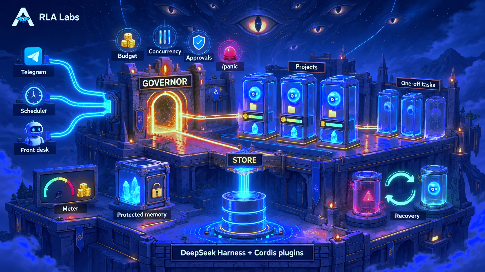

# Argus Agent


Argus is a self-hosted system for running AI agents over days and weeks. It enforces a
budget on every run, asks before risky actions and recovers after a crash. You run
and watch it from a web interface or from Telegram.

**Current release: [0.6.0](https://github.com/rla-labs/argus/releases/tag/v0.6.0)**
(`ghcr.io/rla-labs/argus:0.6.0`). [What's new](docs/user/whats-new.md).

## What it does

**Projects.** A project is a long-running agent with its own folder, model,
instructions, memory and budget. Templates are built in for `site`, `research`,
`reports` and `devops` work.

**Tasks and schedules.** One-off tasks, and cron schedules that fire exactly once even
across restarts. The result is delivered to your chat.

**Control from a chat or a browser.** Commands such as `/status`, `/stop`, `/budget`
and `/panic` are plain code, so they work with no model involved. Every other message
goes to a project word for word.

**Budgets.** Every run passes through one governor, which checks limits before the run
starts and again at every step. Prices refresh by themselves. `/panic` stops everything
in under five seconds.

**Approvals.** Each project has its own permissions (read, write, shell, web).
Risky actions wait for your answer, and no answer counts as no.

**A sandbox.** An agent's commands are confined by the kernel (Landlock) to the
project's own folder. `/undo` restores that folder to what it was before a run.

**Long runs that cannot run away.** A run stops on a loop or after many steps with no
progress. At a checkpoint it asks whether to continue, and a project never passes its
step ceiling.

**Recovery.** A crash loses nothing, and interrupted runs come back as a retry button.
A broken project file sidelines that project only.

**Extensions.** MCP servers and skills installed from git, pinned, and enabled per
project.

## Quick start

You need a Linux server and an API key for a model provider. Telegram is optional.

```sh
git clone https://github.com/rla-labs/argus.git && cd argus
./deploy/scripts/install.sh                  # Docker (recommended)
sudo ./deploy/native/install-native.sh       # or native, with systemd (Node 22, pnpm 8.6.11)
```

The installer asks for what it needs and prints a setup link. With Telegram, send
`/start` to your bot. On the host, `argus status`, `argus doctor`, `argus logs -f`,
`argus backup` and `argus upgrade` work the same for both installs.

The web interface listens only on the server (port 3091). Reach it
[through Tailscale or an SSH tunnel](docs/user/web.md#reach-it-tailscale-recommended).

## Documentation

- [Getting started](docs/user/getting-started.md): from an empty server to a working
  project in ten minutes
- [Three scenarios](docs/user/scenarios.md): a website, a daily report, a file you send
- [Daily use](docs/user/daily-use.md) and [chat commands](docs/user/commands.md)
- [The web interface](docs/user/web.md)
- [Configuration](docs/user/configuration.md) and
  [extensions](docs/user/extensions.md)
- [Backup and upgrades](docs/user/backup-and-upgrade.md),
  [security](docs/user/security.md) and
  [troubleshooting](docs/user/troubleshooting.md)

## How it is built



Argus is a set of Cordis plugins on a pinned version of
[DeepSeek Harness](https://github.com/deepseek-ai/deepseek-harness) (dsh). It does not
patch dsh. Tests enforce these rules:

| Rule | Why |
|---|---|
| Only `ops-governor` starts work. | Nothing gets around a budget or `/panic`. |
| Only `ops-store` writes to the database. | A crash leaves nothing half-written. |
| Commands, schedules and budgets are code. | The controls work when a model is wrong or offline. |
| A project gets your words as you sent them. | No component rewrites your instructions. |
| A missing price, approval or user means no. | A mistake costs a retry, not money. |
| Each project is a separate agent. | Projects never share a conversation, memory or budget. |

## Status

Argus is early. It runs every day on its author's server and has more than 2,000
automated tests. Its installs, upgrades and sandbox are tested end to end. Nobody else
has run it in production yet, and dsh is still a release candidate (`0.2.0-rc.2`). See
[what has been verified](docs/user/whats-new.md#what-has-been-verified), and what has
not.

**Next:** an `office` extension for Word, Excel and PowerPoint (0.7.0). After that,
Slack or Discord, team roles, semantic memory, and metrics. An issue that describes
your use case helps the most.

## Development

```sh
pnpm install
pnpm build && pnpm typecheck && pnpm lint && pnpm test
pnpm test:native-vps      # the native install in a throwaway Ubuntu container
pnpm test:docker-sandbox  # what a project's shell can reach, in the real image
```

`packages/` holds one plugin per folder plus the `argus-agent` bundle. `deploy/` holds
Docker, the native install and the config templates. `test/` holds the spikes,
crash recovery and deploy tests.

## License

[Sustainable Use License](LICENSE.md), the license n8n uses. You may run and change
Argus for yourself or your company, commercial work included. You may not offer it as a
hosted service or sell it.

## Acknowledgements

Argus is built on [DeepSeek Harness](https://github.com/deepseek-ai/deepseek-harness)
and Cordis. Model prices come from the
[AI API Pricing dataset](https://aicostbudget.com/en/datasets/ai-api-pricing)
(CC BY 4.0) and [models.dev](https://models.dev) (MIT), and from DeepInfra's own price
list for DeepInfra. Your provider's invoice is the final word on what you pay.
